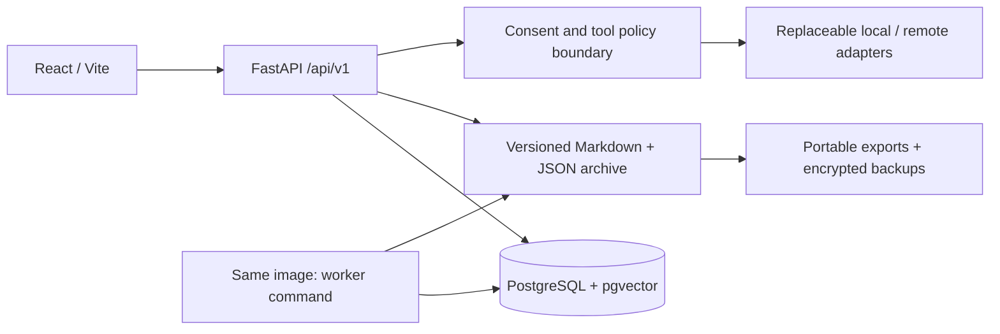

# CLAIRE architecture and implementation plan

Status: pre-release foundation. Production readiness requires every acceptance gate below.

The archive is authoritative; databases are reconstructable operational indexes. UUIDs identify resources independently of names and locations. UTC recording times remain distinct from event dates. Schema versions and immutable revisions preserve original testimony. No graph edge, search result, tool, or administrator role grants implicit access to private content.

Authentication uses Argon2 passwords and opaque revocable sessions stored as hashes. Mutations require same-origin requests and a session-bound CSRF token. Account creation is an operator CLI action, never public registration. Family membership is explicit. Runtime database credentials must not own schema or bypass RLS.

React/Vite avoids an unnecessary second application server: FastAPI serves the compiled interface. Domain modules own identity, archives, provider policy, and worker execution. Optional integrations fail closed until configured and validated.

## Implementation checklist

Implemented foundation: identity, sessions, family-scoped member API, bilingual shell, migration round trip, non-root image, worker heartbeat and CI definitions. Memory workflow supports confirmed creation/editing, current private/family access, owner-only history, tombstones/restoration, title search and event-date ordering. PostgreSQL RLS is tested with a non-bypass role. Archive writes commit before the catalogue; mismatches fail closed and an offline operator command reconciles committed revisions. Local Ollama chat streams and persists private conversations, with bounded keyword retrieval of authorized memories. Owners can download checksummed single-memory revision packages and verify them offline. Semantic retrieval, package import, full backups and automated recovery remain open.

- [ ] Phase 1: runnable frontend/backend, authentication, family isolation, migrations, health/readiness, non-root Compose, CI; run PostgreSQL integration and browser tests.
- [ ] Phase 2: durable revisions with recovery journal, ingestion jobs, hybrid pgvector/FTS retrieval, provenance and citations, streaming provider gateway, per-request remote consent.
- [ ] Phase 3: resource sharing/revocation, timeline and permission-filtered graph, contradictions, EN/FR, archive management.
- [ ] Phase 4: runtime-discovered read-only Immich MCP with user-scoped credentials, local Whisper/Piper, provider replacement tests.
- [ ] Phase 5: checksummed export/import, consistent restic backups and clean-host restore, explicit multi-party succession, secret-free legacy package, approved tools.
- [ ] Phase 6: adversarial privacy tests, dependency/image scanning, SBOM, performance, cross-host recovery exercise, signed versioned publishing.

## Release gates

Do not label production-ready until all 24 original/additional acceptance scenarios pass. In particular: contradictory testimonies coexist; graph/search/chat/MCP cannot expose another user's records; clean install restores portable archives; embedding/local-model replacement leaves archives untouched; successors complete recovery without private-data bypass; recovery packages contain no plaintext secrets; cross-host full restoration is demonstrated.

## Design tokens

White canvas, #104d33 accent, #202722 text, #68716b secondary text, #e0e5e1 borders. System sans-serif controls, Georgia headings. 256px navigation rail, 40px desktop gutters, 8px controls; mobile rail becomes a wrapping navigation area. The generated concept in design-concept.png is the reference. Unimplemented areas must state their status rather than simulate success.

## References

- https://fastapi.tiangolo.com/deployment/docker/
- https://fastapi.tiangolo.com/tutorial/security/oauth2-jwt/
- https://www.postgresql.org/docs/current/ddl-rowsecurity.html
